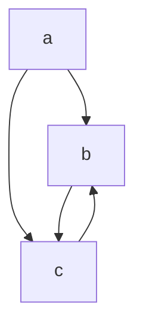
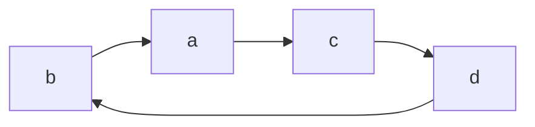

# Relations: แบบฝึก 22 ข้อ

> ส่วนที่ 1 คือโจทย์ (ก๊อปไปฝึกได้เลย) ส่วนที่ 2 คือเฉลยพร้อมเหตุผล

## นิยามไว้เทียบ

| คุณสมบัติ | เงื่อนไข |
|---|---|
| Reflexive | (a, a) ∈ R ทุก a |
| Symmetric | (a, b) ∈ R ⟹ (b, a) ∈ R |
| Antisymmetric | (a, b), (b, a) ∈ R ⟹ a = b |
| Transitive | (a, b), (b, c) ∈ R ⟹ (a, c) ∈ R |
| Equivalence | Reflexive + Symmetric + Transitive |

---

# ส่วนที่ 1: โจทย์

## Relations

จงเลือกคู่อันดับทั้งหมดใน relation R จาก A = {0,1,2,3,4} ไปยัง B = {0,1,2,3}, โดยที่ (a, b) ∈ R เมื่อ

### 1. a = b (1 Point)

- [ ] (0, 0)
- [ ] (0, 1)
- [ ] (0, 2)
- [ ] (0, 3)
- [ ] (1, 0)
- [ ] (1, 1)
- [ ] (1, 2)
- [ ] (1, 3)
- [ ] (2, 0)
- [ ] (2, 1)
- [ ] (2, 2)
- [ ] (2, 3)
- [ ] (3, 0)
- [ ] (3, 1)
- [ ] (3, 2)
- [ ] (3, 3)
- [ ] (4, 0)
- [ ] (4, 1)
- [ ] (4, 2)
- [ ] (4, 3)

### 2. a | b (1 Point)

- [ ] (0, 0)
- [ ] (0, 1)
- [ ] (0, 2)
- [ ] (0, 3)
- [ ] (1, 0)
- [ ] (1, 1)
- [ ] (1, 2)
- [ ] (1, 3)
- [ ] (2, 0)
- [ ] (2, 1)
- [ ] (2, 2)
- [ ] (2, 3)
- [ ] (3, 0)
- [ ] (3, 1)
- [ ] (3, 2)
- [ ] (3, 3)
- [ ] (4, 0)
- [ ] (4, 1)
- [ ] (4, 2)
- [ ] (4, 3)

---

กำหนดให้ความสัมพันธ์ R บน set {1, 2, 3, 4} จงหาว่า R มีคุณสมบัติ reflexive, symmetric, antisymmetric, transitive หรือไม่ (อาจมีมากกว่า 1 คำตอบ)

### 3. {(2,4),(4,2)} (1 Point)

- [ ] Reflexive
- [ ] Symmetric
- [ ] Antisymmetric
- [ ] Transitive
- [ ] ไม่มีคุณสมบัติใดเลย

### 4. {(1,1),(2,2),(3,3),(4,4)} (1 Point)

- [ ] Reflexive
- [ ] Symmetric
- [ ] Antisymmetric
- [ ] Transitive
- [ ] ไม่มีคุณสมบัติใดเลย

### 5. {(1,3),(1,4),(2,3),(2,4),(3,1),(3,4)} (1 Point)

- [ ] Reflexive
- [ ] Symmetric
- [ ] Antisymmetric
- [ ] Transitive
- [ ] ไม่มีคุณสมบัติใดเลย

---

กำหนดให้ความสัมพันธ์ R บน set ของมนุษย์ทุกคน จงหาว่า R มีคุณสมบัติ reflexive, symmetric, antisymmetric, transitive, equivalence หรือไม่ โดย (a, b) ∈ R ก็ต่อเมื่อเข้าเงื่อนไขดังต่อไปนี้

### 6. นาย a สูงกว่านาย b (1 Point)

- [ ] Reflexive
- [ ] Symmetric
- [ ] Antisymmetric
- [ ] Transitive
- [ ] Equivalence
- [ ] ไม่มีคุณสมบัติใดเลย

### 7. นาย a กับนาย b เกิดวันเดียวกัน (1 Point)

- [ ] Reflexive
- [ ] Symmetric
- [ ] Antisymmetric
- [ ] Transitive
- [ ] Equivalence
- [ ] ไม่มีคุณสมบัติใดเลย

---

กำหนดให้ความสัมพันธ์ R บน set ของจำนวนจริงทุกตัว จงหาว่า R มีคุณสมบัติ reflexive, symmetric, antisymmetric, transitive, equivalence หรือไม่ โดย (x, y) ∈ R ก็ต่อเมื่อเข้าเงื่อนไขดังต่อไปนี้

### 8. x + y = 0 (2 Points)

- [ ] Reflexive
- [ ] Symmetric
- [ ] Antisymmetric
- [ ] Transitive
- [ ] Equivalence
- [ ] ไม่มีคุณสมบัติใดเลย

### 9. x = 2y (1 Point)

- [ ] Reflexive
- [ ] Symmetric
- [ ] Antisymmetric
- [ ] Transitive
- [ ] Equivalence
- [ ] ไม่มีคุณสมบัติใดเลย

### 10. xy ≥ 0 (2 Points)

- [ ] Reflexive
- [ ] Symmetric
- [ ] Antisymmetric
- [ ] Transitive
- [ ] Equivalence
- [ ] ไม่มีคุณสมบัติใดเลย

### 11. x = 1 (2 Points)

- [ ] Reflexive
- [ ] Symmetric
- [ ] Antisymmetric
- [ ] Transitive
- [ ] Equivalence
- [ ] ไม่มีคุณสมบัติใดเลย

---

กำหนดให้ความสัมพันธ์ R บน set ของนักศึกษาคณะไอทีทั้งหมด จงหาว่า R มีคุณสมบัติ reflexive, symmetric, antisymmetric, transitive, equivalence หรือไม่ โดย (a, b) ∈ R ก็ต่อเมื่อเข้าเงื่อนไขดังต่อไปนี้

### 12. นักศึกษา a และนักศึกษา b ลงทะเบียนเรียนวิชาเดียวกันอย่างน้อย 1 วิชาในเทอม 02/2026 (2 Points)

- [ ] Reflexive
- [ ] Symmetric
- [ ] Antisymmetric
- [ ] Transitive
- [ ] Equivalence
- [ ] ไม่มีคุณสมบัติใดเลย

### 13. (2 Points)

ฝ่ายทะเบียนคณะค้นพบว่านักศึกษาคณะไอทีที่ทุกคนลงทะเบียนเรียนวิชาในเทอม 02/2026 อยู่ระหว่าง 4 ถึง 7 วิชา

กำหนดให้ (a, b) ∈ R ก็ต่อเมื่อ a และ b ลงทะเบียนเรียนวิชาด้วยจำนวนวิชาที่เท่ากัน

จงหาคำตอบว่าจำนวนที่มากที่สุดที่เป็นไปได้ของ Equivalence Class ที่แตกต่างกันของ R คือเท่าใด

- [ ] 4
- [ ] 5
- [ ] 6
- [ ] 7
- [ ] ไม่มีจำนวนที่มากที่สุด เพราะขึ้นกับจำนวนนักศึกษาใดๆก็ได้

---

## Equivalence Class

### 14. กำหนดให้ R บนเซต ℤ โดย (a, b) ∈ R ก็ต่อเมื่อ a ≡ b (mod 5) (1 Point)

ข้อใดคือเซตของ [17]_R

- [ ] {..., −8, −3, 2, 7, 12, ...}
- [ ] {..., −7, −2, 3, 8, 13, ...}
- [ ] {..., −4, −1, 2, 5, 8, ...}
- [ ] {..., −13, −3, 7, 17, 27, ...}
- [ ] ไม่มีข้อใดถูก

### 15. กำหนดให้ R บนเซต ℝ โดย (a, b) ∈ R ก็ต่อเมื่อ x − y ∈ ℤ (2 Points)

ข้อใดคือเซตของ [0.5]_R

- [ ] {0.5}
- [ ] {..., −1.5, −0.5, 0.5, 1.5, 2.5, ...}
- [ ] {..., −1, −0.5, 0, 0.5, 1, 1.5, ...}
- [ ] {0.5, 1.5, 2.5, 3.5, ...}
- [ ] ไม่มีข้อใดถูก

### 16. (2 Points)

กำหนดให้ A = {1, 2, 3, ..., 10} และกำหนดให้ R บนเซต A โดย (a, b) ∈ R ก็ต่อเมื่อ a และ b มีจำนวน positive divisor (ตัวหารที่เป็นจำนวนเต็มบวก) ที่เท่ากัน

ข้อใดคือเซตของ [4]_R

- [ ] {4}
- [ ] {4, 9}
- [ ] {2, 4, 8}
- [ ] {4, 6, 8, 9, 10}
- [ ] ไม่มีข้อใดถูก

### 17. (2 Points)

กำหนดให้ T = {แคร์, เนยสด, โฟล์ค, เนิส, แมน} และเซตของวิชาที่แต่ละคนลงทะเบียนหรือ C(x) เป็นดังนี้

- C(แคร์) = {Calculus, Maths for IT}
- C(เนยสด) = {Calculus}
- C(โฟล์ค) = {Maths for IT, Calculus}
- C(เนิส) = {Prob & Stats}
- C(แมน) = {Calculus}

และกำหนดให้ R บนเซต T โดย (x, y) ∈ R ก็ต่อเมื่อ C(x) = C(y)

ข้อใดคือเซตของ [แคร์]_R

- [ ] {แคร์}
- [ ] {โฟล์ค}
- [ ] {แคร์, โฟล์ค}
- [ ] {แคร์, เนยสด}
- [ ] {แคร์, เนยสด, โฟล์ค}
- [ ] ไม่มีข้อใดถูก

---

## เมทริกซ์

จงหาคำตอบว่าเมทริกซ์ต่อไปนี้มีคุณสมบัติใดบ้าง

```
a)  [1 0 1]     b)  [0 1 0]     c)  [1 1 1]
    [0 1 0]         [0 1 0]         [1 0 1]
    [1 0 1]         [0 1 0]         [1 1 1]
```

### 18. a) (1 Point)

- [ ] Reflexive
- [ ] Symmetric
- [ ] Antisymmetric
- [ ] ไม่มีคุณสมบัติใดเลย

### 19. b) (1 Point)

- [ ] Reflexive
- [ ] Symmetric
- [ ] Antisymmetric
- [ ] ไม่มีคุณสมบัติใดเลย

### 20. c) (1 Point)

- [ ] Reflexive
- [ ] Symmetric
- [ ] Antisymmetric
- [ ] ไม่มีคุณสมบัติใดเลย

---

## กราฟ

จงหาว่า graphs ต่อไปนี้มีคุณสมบัติ reflexive, symmetric, antisymmetric, transitive, equivalence หรือไม่

### 21. (1 Point)

edges: (a,b), (a,c), (b,c), (c,b)



- [ ] Reflexive
- [ ] Symmetric
- [ ] Antisymmetric
- [ ] Transitive
- [ ] ไม่มีคุณสมบัติใดเลย

### 22. (1 Point)

edges: (b,a), (a,c), (c,d), (d,b)



- [ ] Reflexive
- [ ] Symmetric
- [ ] Antisymmetric
- [ ] Transitive
- [ ] ไม่มีคุณสมบัติใดเลย

---

# ส่วนที่ 2: เฉลย

## ตารางสรุป

| ข้อ | คำตอบ |
|---|---|
| 1 | (0,0), (1,1), (2,2), (3,3) |
| 2 | (1,0), (1,1), (1,2), (1,3), (2,0), (2,2), (3,0), (3,3), (4,0) |
| 3 | Symmetric |
| 4 | Reflexive, Symmetric, Antisymmetric, Transitive |
| 5 | ไม่มีคุณสมบัติใดเลย |
| 6 | Antisymmetric, Transitive |
| 7 | Reflexive, Symmetric, Transitive, Equivalence |
| 8 | Symmetric |
| 9 | Antisymmetric |
| 10 | Reflexive, Symmetric |
| 11 | Antisymmetric, Transitive |
| 12 | Reflexive, Symmetric |
| 13 | 4 |
| 14 | ข้อ 1: {..., −8, −3, 2, 7, 12, ...} |
| 15 | ข้อ 2: {..., −1.5, −0.5, 0.5, 1.5, 2.5, ...} |
| 16 | ข้อ 2: {4, 9} |
| 17 | ข้อ 3: {แคร์, โฟล์ค} |
| 18 | Reflexive, Symmetric |
| 19 | Antisymmetric |
| 20 | Symmetric |
| 21 | ไม่มีคุณสมบัติใดเลย |
| 22 | Antisymmetric |

## เหตุผล

**ข้อ 1:** a = b และ b ต้องอยู่ใน B (4 ∉ B จึงไม่มี (4,4))

**ข้อ 2:** a | b คือมี c ที่ b = a·c, a ≠ 0 ตามนิยามมาตรฐาน

| a | b ที่ a หารลงตัว |
|---|---|
| 0 | ไม่มี |
| 1 | 0, 1, 2, 3 |
| 2 | 0, 2 |
| 3 | 0, 3 |
| 4 | 0 |

⚠️ (0,0) ไม่นับ ถ้าอาจารย์ใช้นิยามที่ยอมให้ 0 | 0 จะเป็น 10 คู่ ให้เช็กกับโน้ตในคลาส

**ข้อ 3:** ไม่ Reflexive ((1,1) ไม่มี) / Symmetric / ไม่ Antisymmetric (มี (2,4) และ (4,2)) / ไม่ Transitive ((2,4),(4,2) ต้องมี (2,2))

**ข้อ 4:** identity relation จึงครบทั้ง 4 คุณสมบัติ

**ข้อ 5:** ไม่ Reflexive / ไม่ Symmetric ((1,4) ไม่มี (4,1)) / ไม่ Antisymmetric ((1,3) และ (3,1)) / ไม่ Transitive ((2,3),(3,1) ต้องมี (2,1))

**ข้อ 6:** ไม่ Reflexive / ไม่ Symmetric / Antisymmetric แบบ vacuously true (เงื่อนไข "a สูงกว่า b และ b สูงกว่า a" เป็นไปไม่ได้) / Transitive

**ข้อ 7:** Equivalence (ไม่ Antisymmetric เพราะคนต่างกันเกิดวันเดียวกันได้)

**ข้อ 8:** ไม่ Reflexive ((1,1)) / Symmetric / ไม่ Antisymmetric ((1,−1),(−1,1)) / ไม่ Transitive ((1,−1),(−1,1) ต้องมี (1,1))

**ข้อ 9:** ไม่ Reflexive / ไม่ Symmetric ((2,1) ไม่มี (1,2)) / Antisymmetric (x = 2y และ y = 2x ⟹ x = y = 0) / ไม่ Transitive ((4,2),(2,1) ต้องมี (4,1))

**ข้อ 10:** Reflexive (x² ≥ 0) / Symmetric / ไม่ Antisymmetric ((1,2),(2,1)) / ไม่ Transitive ((1,0),(0,−1) แต่ (1,−1) ผลคูณ −1)

**ข้อ 11:** ⚠️ โจทย์เขียนไม่ชัด ตีความว่า (x, y) ∈ R เมื่อ x = 1 (y อะไรก็ได้) / ไม่ Reflexive ((2,2)) / ไม่ Symmetric ((1,2) ไม่มี (2,1)) / Antisymmetric (มีทั้ง (x,y),(y,x) ⟹ x = y = 1) / Transitive (x = 1 ⟹ (x,z) ∈ R)

**ข้อ 12:** Reflexive (ทุกคนลงอย่างน้อย 1 วิชา) / Symmetric / ไม่ Antisymmetric / ไม่ Transitive (a-b ร่วมวิชา X, b-c ร่วมวิชา Y แต่ a-c อาจไม่มีวิชาร่วม)

**ข้อ 13:** class หนึ่งคือกลุ่มที่ลงจำนวนวิชาเท่ากัน จำนวนวิชาที่เป็นไปได้ 4, 5, 6, 7 จึงมีได้มากสุด 4 class

**ข้อ 14:** 17 mod 5 = 2 จึงได้ ..., −3, 2, 7, 12, ...

**ข้อ 15:** [0.5] = 0.5 + จำนวนเต็มใดๆ (ข้อ 3 ผิดเพราะรวม 0, 1 ที่ต่างจาก 0.5 ไม่เป็นจำนวนเต็ม)

**ข้อ 16:**

| n | 1 | 2 | 3 | 4 | 5 | 6 | 7 | 8 | 9 | 10 |
|---|---|---|---|---|---|---|---|---|---|---|
| จำนวนตัวหาร | 1 | 2 | 2 | **3** | 2 | 4 | 2 | 4 | **3** | 4 |

**ข้อ 17:** C(แคร์) กับ C(โฟล์ค) เป็นเซตเดียวกัน (ลำดับไม่สำคัญ) ส่วนเนยสด/แมนมีแค่ {Calculus} เนิสเป็น {Prob & Stats}

**ข้อ 18 (a):** เส้นทแยง 1,1,1 → Reflexive / m13 = m31 = 1 สมมาตร → Symmetric / ไม่ Antisymmetric (m13 = m31 = 1)

**ข้อ 19 (b):** เส้นทแยง 0,1,0 → ไม่ Reflexive / m12 = 1 แต่ m21 = 0 → ไม่ Symmetric / ไม่มีคู่ i ≠ j ที่เป็น 1 พร้อมกัน → Antisymmetric

**ข้อ 20 (c):** m22 = 0 → ไม่ Reflexive / สมมาตร → Symmetric / m12 = m21 = 1 → ไม่ Antisymmetric

**ข้อ 21:** ไม่มี loop / (a,b) ไม่มี (b,a) / (b,c),(c,b) ทั้งคู่ แต่ b ≠ c / (b,c),(c,b) ต้องมี (b,b) แต่ไม่มี → ไม่มีคุณสมบัติใดเลย

**ข้อ 22:** ไม่มี loop / (b,a) ไม่มี (a,b) / ไม่มีคู่สองทิศทาง → Antisymmetric / (b,a),(a,c) ต้องมี (b,c) แต่ไม่มี → ไม่ Transitive
